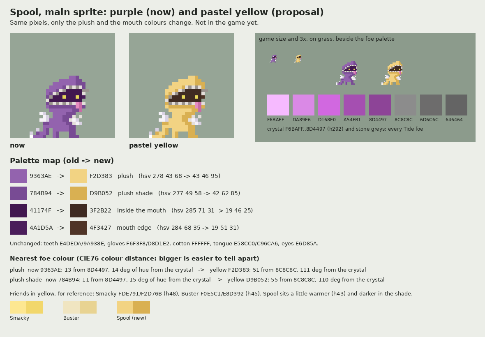

# Spool in pastel yellow: the main sprite, as an example (2026-11-05)

**A proposal, not wired.** Dimitri, 2026-11-05: "Spool's current color scheme is too similar to enemy units. Swap
Spool's color scheme to pastel yellow, but only recolor the main sprite for now so I can see an example." The game
still draws Spool in purple from `SpoolCharacter.P` (`Assets/SpoolMod/Editor/SpoolCharacter.cs`); nothing here is read
by a build.

| File | What |
| --- | --- |
| `game_size/Spool_Pastel.png` | 32 x 32, the main sprite (his reshade, the rest frame and the icon) in the new colours |
| `aseprite/Spool_Pastel.aseprite` | the same, one frame, layer "TEMP art" |
| `preview_8x/Spool_Pastel_8x.png` | 8x on the house checker |
| `preview_8x/Spool_Pastel_compare.png` | now and proposed side by side at 8x, at game size and 3x on grass beside the foe palette, the palette map and the distances below |

Generator: `concept-tools/temp_art/spool_pastel.py`. It reads `Front` and `P` from `SpoolCharacter.cs`, so the "now"
picture is exactly what the game builds (it equals the project files' `concepts/vessels_2026-10-09/v3_flat/game_size/spool_reshade.png`
pixel for pixel, checked 2026-11-05).

## Palette map

Only the purple family changes: 147 of the sprite's 195 pixels, none moved. The shade keeps the hue within 2 degrees
and gains saturation, the mouth's dark is a warm near-black (kit `docs/18` §3).

| Key | Role | Old | New | Old h s v | New h s v |
| --- | --- | --- | --- | --- | --- |
| `a` | plush | `9363AE` | `F2D383` | 278 43 68 | 43 46 95 |
| `b` | plush shade | `784B94` | `D9B052` | 277 49 58 | 42 62 85 |
| `m` | inside the mouth | `41174F` | `3F2B22` | 285 71 31 | 19 46 25 |
| `n` | mouth edge | `4A1D5A` | `4F3427` | 284 68 35 | 19 51 31 |

Unchanged: teeth and cuffs `E4DEDA` / `9A938E`, gloves `F6F3F8` / `D8D1E2`, cotton `FFFFFF`, tongue `E58CC0` /
`C96CA6`, eyes `E6D85A`. The severed arm on the floor keeps its white cotton end against the new shade.

## What it was compared against

- **Every Tide foe** (kit `docs/18` §5.1, `TDS_Vessel_Creator/reference/palettes/tds_foes.gpl`): the magenta crystal
  `F6BAFF` `DA89E6` `D168E0` `A54FB1` `8D4497` (h292) and the stone greys `8C8C8C` `6D6C6C` `646464`. Spool's plush was
  13 (shade 11) CIE76 units from the crystal's `8D4497` and 14-15 degrees of hue from it; the yellow is 51 (shade 55)
  from the nearest foe colour, a grey, and 110-111 degrees of hue from the crystal. The mouth's dark sits about as far
  from the stone grey (26, edge 25) as the old one sat from the crystal (29, edge 24); it is small and inside the hood.
- **The elite skins** (material tints over foes, `reference/art_survey_2026-10-15.txt` part 3): Hardened green,
  Superheated white, Tempered red, Fractured near-black, Annealed a faint bronze (h22, 6% alpha), Molten orange-red.
  None is yellow; Annealed is the nearest hue and too faint to read as a colour.
- **Friends in yellow** (`tds_base_vessels.gpl`): Smacky's head `FDE791` / `F2D76B` (h48) and Buster `F0E5C1` /
  `E8D392` (h45-46). Spool sits a little warmer (h43) with a darker shade; his hood, mouth and gloves tell him apart.
  The kit's rule (`docs/18` §4.2, no saturated hue in 270-320 degrees) now holds for Spool, so its §7 exception would go
  once the follow-up lands.

## Follow-up, if Dimitri says yes

Swapping the four keys in `SpoolCharacter.P` recolours every 32 px vessel frame at once (idle, walk, attack, Patch,
fall, landing, the boat mini, the icon, the end-screen poses), since they are all drawn from it. Beyond that, each its
own yes or no:

1. Spool's vessel sheets through `SpoolCharacter.P` (the four keys above): one code change, then a PC round to look.
2. The UI colour: `Purple` in `ModSource/Spool/Code/04_Content.cs` and `Code/13_Journal.cs` (`Displaycolor`, journal), the death
   puff's `9363AE` in `Assets/SpoolMod/Editor/SpoolBuilder.cs`, the splash and tab icon (drawn in the eyes' yellow: may want a darker line).
3. The Thread Head and the four Crafted (`Art/Temporary/game_size/`, his 2026-11-05 picks), purple and lilac now.
4. Spool's thread, which is lilac everywhere: the ground tuft, `SpoolClient.ThreadColor`, the needle's tail, the
   Patch thread (`l`, `L` in `P`), and the models' felt (the palette's `9363AE` in `Assets/SpoolMod/Editor/SpoolLowpoly.cs`, built into `Assets/SpoolMod/Art/Models/Spool_Palette.png`).
5. The docs that name his purple: `docs/STYLE.md` roster row, kit `docs/18` §7.
