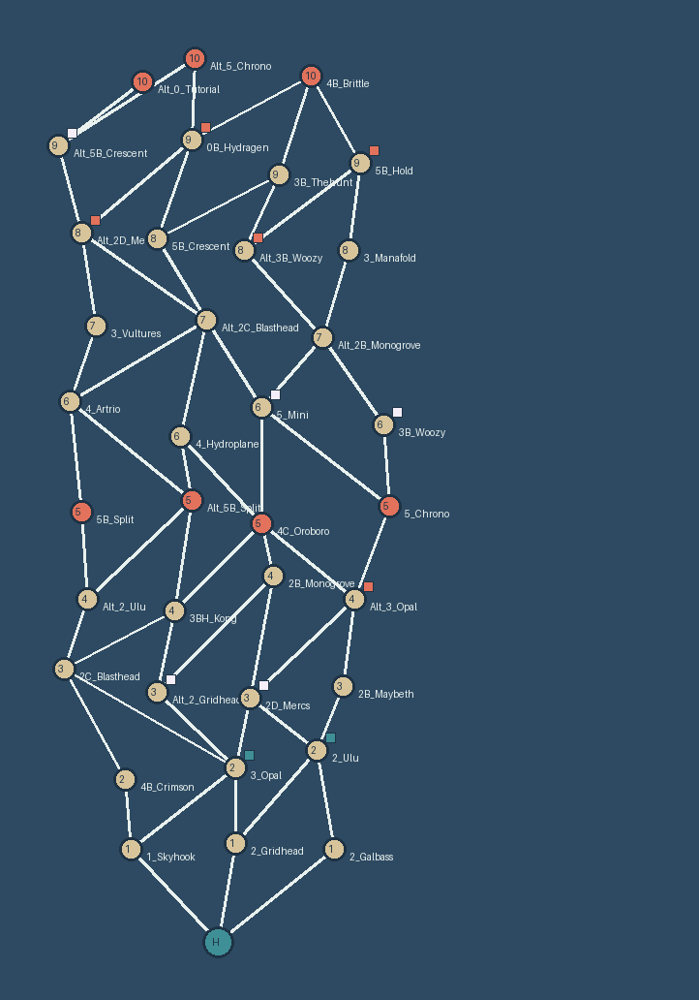

# A sea chart for choosing maps (2026-10-09)

Dimitri asked (2026-10-09 21:52Z) whether, when the players choose a map, their boat could sail around a generated
map the way it sails the base game's campaign map, with movement points generated in game like Slay the Spire's.
This page answers it from the game's code and proposes a route. **Adopted by Dimitri 2026-10-09 22:23Z with
route V1** (§4, §6); the scope's rundown (`docs/scope/05_Gameplay_Rundown.txt`) says so.

Tags: **proven** = shown in game by Riptide or RogueLab; **read** = from the decompiled `Assembly-CSharp.dll` (kit
`docs/13` §11), file:line into that folder; **untested** = needs the PC (§5). Kit paths: `docs/NN` =
`TDS_Vessel_Creator/docs/`. The engine facts are filed once in kit `docs/15` §17.

## 1. Answer

**Yes, it can be built, on the game's own world map system** (read). The base campaign map is not a picture: it is a
3D scene of nodes, each a component that names its neighbours and, for a map node, the map it plays. The boat sails
to whichever node the leader picks next, from the arrows the game draws to the current node's neighbours. That is
already a Slay the Spire map; the base game's is just hand-made. A mod can build the same nodes from code with a seed,
register them as a world of its own, and the game's own boat, camera, arrows, Setup panel and map loading work on
them unchanged. Three things are not free: the chart needs its own sea art, the clients must build the identical
chart (a seed carried in the world's name does it), and **only the leader can steer**, so the vote needs a route
(§4). None of it has been tried in game; §5 is the PC round that would prove it.

A preview from the prototype generator (`concept-tools/sea_chart.py`, seed 20261009): the harbour at the bottom, ten
rows of 3-4 maps, red rows close each stretch of five.

## 2. How the base campaign map works (read)

| Piece | What it is | Where |
| --- | --- | --- |
| A world | `Mapworlddatabaseobject` in `Tds_Masterdatabase` folder `"World"`: a prefab `Worldobj`, default lighting, a `Defaultnode`, a name and description for the title card, a soundtrack | Mapworlddatabaseobject.cs:7-20 |
| A node | `Macro_Link_Add_Base` on a child of the world: `Links` (the neighbours), `Unlockcondition`, `Cameraposition`, `Boat_Radius`, `Boat_Warp`, `Node_Hidden`, `Waypointspot` | Macro_Link_Add_Base.cs:4-24 |
| Node kinds | `Macro_Maplink_Add` (plays a `Gameplan`, optional `Altgameplan`), `Macro_Nodelink_Add` (a stop with no map), `Macro_Warplink_Add` (sails to another world: `Toworld`, `Landingspot`) | Macro_Maplink_Add.cs, Macro_Nodelink_Add.cs, Macro_Warplink_Add.cs |
| Loading it | the boat's `Macro_Main.Startup` reads the world name from `Tds_Multiplayerinfo.World` (the host takes it from its save's `Player_Worldselect`) and waits until `Getitem("World", name)` finds it; `Macro_Worldvisual.Changeworld` instantiates `Worldobj` | Macro_Main.cs:356-365, 401-411; Macro_Worldvisual.cs:95-117 |
| Moving | the leader hovers the current node; the game draws a "go to" arrow per entry of its `Links` (skipping locked ones); picking an arrow makes that node `Hovering` and the boat sails there | Macro_Worldui.cs:428-470; Macro_Nodeselect_Click.cs; Macro_Main.cs:583-670 |
| The boat | on the leader, each frame: sail straight at the hovered node's nearest `Dock` child (or the node itself), speed ramping 2 to 10 units/s, camera to the node's `Cameraposition`; sent to everyone through `Moveboat_ServerRpc` into networked `Boatpos`/`Boatdir`/`Campos`/`Camdir`; clients only follow | Macro_Worldvisual.cs:71-77, 1409-1760; Macro_Main.cs:68-104 |
| Picking a map | a second click on a map node calls `Selectmap_ServerRpc(nodeName)`; the host finds the `Macro_Maplink_Add` of that name in its scene, writes the Gameplan's four strings and `Selected`, which opens the Setup panel on every machine; ready-up starts it | Macro_Main.cs:626-635; Tds_Multiplayer_Remote.cs:600-696 |
| Who steers | **the leader only**: clicks, arrows and `Selectmap`, `Pingnode`, `Selectworld` all check `Currentleader` | Macro_Main.cs:599, 725; Tds_Multiplayer_Remote.cs:648, 741, 809, 867 |
| Warping | `Selectworld_ServerRpc` sets `Tds_Multiplayerinfo.World`, `Selected` (the landing node) and `Macro_Main.Worlded`; every machine's `Moveworld` swaps the world with the "between worlds" title card; a frame-by-frame fallback swaps any machine whose world doesn't match `Worlded` | Tds_Multiplayer_Remote.cs:827-885; Macro_Main.cs:209-244; Macro_Worldvisual.cs (end of `Update`) |
| After a map | the end screen's return vote sends everyone to `Setup` (the boat) with the lobby **Open** again | Tds_Multiplayer_Remote.cs:30-57 |

The links are the whole of the routing: the boat goes in a straight line, and the arrows only ever offer the current
node's `Links`. A mod that writes `Links` decides where the boat may go next.

## 3. The route: a generated chart

| Step | Who | What the mod does | Evidence |
| --- | --- | --- | --- |
| 1. Generate | host, at New campaign | Picks a seed; builds the chart: a harbour, then 10 rows of 3-4 nodes, non-crossing links (`concept-tools/sea_chart.py`, xorshift32 so the C# port is exact); assigns each node a base map by the stretch rule (`docs/SCOPE_VS_LOOP.md` #20: low labels early, δ late, a Breaker map closing rows 5 and 10, no map twice) | plain code |
| 2. Save | host | The campaign save gains the seed and the route so far (one column per row) | the save: **proven** (`docs/15` §8) |
| 3. Build the world | every machine | A `Mapworlddatabaseobject` made in code (`ScriptableObject.CreateInstance`), named `RW_Chart_<seed>_<route>`, with a `Worldobj` built from the seed: a sea, one island per node with a `Macro_Maplink_Add` (its `Gameplan` the map's Rogue twin, `Links` set, a `Cameraposition` and `Dock` child), and route lines; registered in `Items["World"]` | registering database items: **proven** for Mode, Gameplan, Artifact (RogueLab); a World item and a code-built `Worldobj`: **untested** |
| 4. Sail in | host's mod, on the boat | After the boat opens, warps the party to the chart the way `Selectworld` does: sets `Tds_Multiplayerinfo.World` and `Worlded` to the chart's name and `Selected` empty; the chart's `Defaultnode` is the node the party stands on | the warp path: **read**; doing it from a mod: **untested** |
| 5. Clients | each client's mod | Sees `Tds_Multiplayerinfo.World` start with `RW_Chart_`, builds the same chart from the seed and route in the name and registers it; the game's own fallback swaps the world once the item exists | **read** (fallback in `Macro_Worldvisual.Update`); **untested** |
| 6. Choose | see §4 | The next row's linked nodes are the choices (1-3) | |
| 7. Sail and load | host's mod | Sets the chosen node as the leader's `Hovering`: the stock boat sails there; on arrival calls `Selectmap_ServerRpc(node)`; the Setup panel opens on everyone's screen; players ready up and the map loads in the mod's mode | `Selectmap_ServerRpc` from a mod: **proven** (RogueLab, Riptide); the sail: **read** |
| 8. Come back | host | After the map is left (or lost), returns everyone to the boat (the stock return), then step 4 again with the route one longer | return to the boat: **read** |

Things the code reading turned up that the build must respect:

- **Every node needs a `Cameraposition`.** The leader's boat code reads `Prevhovering.Cameraposition.transform`
  without a null check (Macro_Worldvisual.cs:1694).
- **Never let the save keep the chart's name.** `Startup` waits for the saved world with no timeout
  (Macro_Main.cs:404): if `Player_Worldselect` held `RW_Chart_...` and the pack were removed, the boat would hang on
  its loading screen. The leader's map click writes `Player_Worldselect` (Macro_Main.cs:633), so the mod rewrites it
  to the stock world after every select. Warping in after the boat opens (step 4) keeps the chart out of the save.
- **The world's name is the only channel to clients on the boat** (no entities there, `docs/15` §6), and it is a
  64-byte string: `RW_Chart_` + a 10-digit seed + one digit per row is 29 bytes.
- Hide the stock "Warp" (waypoint) button on the chart and give no node `Waypointspot`.

**What it replaces in the vote flow** (adopted):

- The vote offers the linked nodes of the next row (usually 2, sometimes 1 or 3), not 3 random maps. Players see the
  whole chart ahead, so they plan a route, as in Slay the Spire. A chart can't give every node 3 choices without
  crossing lines; the generator could be told to, at the cost of the look.
- The maps of a campaign are fixed by the seed when it starts, by the stretch rule, instead of drawn at each vote.
- Between maps the party goes back to the boat instead of chaining straight into the next map (`docs/15` §3). That
  costs one load per map, and it reopens the lobby, so a dropped friend or a new one can join between maps, which the
  scope's Continue rule wants anyway.
- If the vote happens on the boat (§4 V2), the map-1 staging step (`docs/15` §6) goes away: map 1 is picked on the
  chart like the others. The Direction picks stay in each map's opening break.
- A lost map's retry replays the same node; the boat doesn't move.

## 4. Who chooses: the vote

The base game lets only the leader steer (§2). Three ways to keep the scope's "every map is voted":

| | Route | Verdict |
| --- | --- | --- |
| V1 | **Vote in the map, sail on the boat.** The map's last vote (leave) is followed by the "where next" vote in the same dialog, over the proven channel (vessel commands and `Runprompt`, `docs/15` §6). On the boat the host's mod sails to the winner by itself. Map 1 keeps today's staging step, or the leader picks map 1 on the chart | works with proven pieces; the chart is a display for every map but the first |
| V2 | **Vote on the boat.** Each client's mod opens a `Runprompt` of the choices on the boat and writes the pick into its own player's `Displayname`, the one networked value a client may write (Blm_Player.cs:30, owner write) and every machine sees; the host counts, sails, and puts the names back. Map 1 is voted the same way | best to play; **untested**, and a name with a vote mark shows in chat for a moment |
| V3 | **The leader steers.** As in the base game; the others talk | no work; drops the scope's vote |

**Chosen: V1** (Dimitri, 22:23Z). Map 1 (default taken): the vote is held in the staging map's opening break, as
today, then the party returns to the boat and sails from the harbour to the winner, so map 1 gets its trip too. Rejected: carrying votes in `Changeartifact_ServerRpc` (any
client may add to the shared Cardinal list, Tds_Multiplayer_Remote.cs:296, but it doesn't say who) or in
`Changehero_ServerRpc` (it swaps the voter's vessel).

**Rejected: re-wiring the stock campaign map** instead of a chart of our own. The mod could rewrite the stock
nodes' `Links` and hide the rest (`Macro_Main.Blacklist`), so the boat sails the real islands. But the 45 maps are
spread over several worlds joined by warps, a choice can't span two of them, and it isn't a generated map.

## 5. What only the PC can prove: a RogueLab round

Solo, automated, one launch, then one online check for C7 (C8 stays here in case V2 is wanted later):

| # | Probe | Pass when |
| --- | --- | --- |
| C1 | Register a code-built World (`RW_Chart_<seed>_`) with 11 rows of nodes on the host and warp to it (step 4) | the title card shows its name; `Macro_Worldvisual.World` is the chart; no exception |
| C2 | Hover the harbour | one "go to" arrow per link; log each arrow's target |
| C3 | Set the next node as `Hovering` from code | the boat sails there and stops at its `Dock`; log the time and the camera |
| C4 | `Selectmap_ServerRpc` on a chart node | the Setup panel opens on it and Start loads its map in the mod's mode |
| C5 | Win or leave the map | back on the boat, warped onto the chart with the route one longer, the boat at the new node |
| C6 | Read the save after C5 | `Player_Worldselect` is still a stock world |
| C7 | Online: a client joins on the boat | it builds the same chart (same node names and positions in its log) and sees the boat move |
| C8 | Online: the client votes through its `Displayname` (V2) | the host logs the vote under the client's `Sessionid`; the name is restored |

Art for the chart (a sea, islands, route lines, a node marker for the Breaker rows) is separate work for
`docs/STYLE.md`; the round can use plain shapes.

## 6. Decided

1. **The sea chart is adopted** (Dimitri, 2026-10-09 22:23Z): the vote picks among the next row's linked maps (1-3),
   the campaign's maps are fixed by the seed, and the party returns to the boat between maps.
2. **V1**: the vote is held in the map; the boat sails to the winner on its own.
