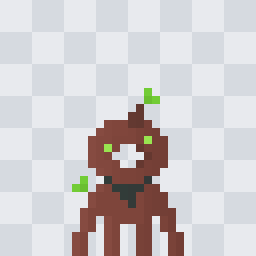
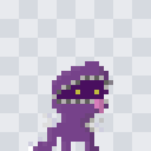
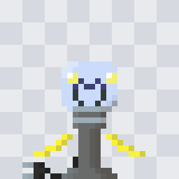

# Yossele, Spool, Uloe: concept page (draft, 2026-10-08)

A first concept for three of the scope's four vessels, built from two sources and nothing else: the user's sprite
concepts (`art/`, copied from `Desktop\RogueWave\sprites` on 2026-10-08) and the vessel text in `docs/SCOPE_v0.txt`,
plus the user's decisions in `docs/PLAN.md` Part C. It is not a design: numbers, upgrade trees and ids come at each
vessel's Phase 3 design gate (`DESIGN.md` from `TDS_Vessel_Creator/template/DESIGN_TEMPLATE.md`). Where the art and the
text disagree, this page says so (§5) instead of choosing. Every name below is the user's.

| Yossele | Spool | Uloe |
| :---: | :---: | :---: |
|  |  |  |
| **The Patient Golem** | **Crafty Crafted Crafter** | **Light Personified** |
| Scaling: towers grow stronger the longer they live | A disposable minion army, paid in Thread | Light makes towers stronger; Photons mark and blind foes |
| 14 × 21 px, browns + leaf green | 18 × 19 px, purples + stitch grey, pink, yellow | 22 × 21 px, glass blue + steel grey + yellow |

Each sprite is one 32 × 32 frame, one layer, front-facing, standing on the frame's bottom edge and centred on x = 16,
which is the game's bottom-centre pivot (`TDS_Vessel_Creator/docs/03` §1). None has a black outline. Previews here are
8× with a checkerboard for transparency; the `.ase`/`.aseprite` sources sit beside them.

---

## 1. Yossele, The Patient Golem

**Fantasy (scope).** "Keeping your towers alive grants bonuses to them": a growing defence. Yossele is "slightly more
powerful statwise" (more health, damage and health regen) so it can hold the base while its towers ramp up. It earns
**fertilizer** to speed a tower's growth. The loop is time management, slow growth, and keeping important buildings
safe.

**What the art shows.**
- A clay or earthen golem in five browns (`864B41` lit side to `733E35` shade), lit from the left.
- A round head with a **see-through hole** in the middle (transparent pixels, not a dark mouth), a short stalk on top
  and a two-leaf **sprout** above it; a second sprout floats off the left shoulder. Leaf greens `72CC35` / `6ABE30`.
- Two bright green eyes (`99E550`) on either side of the hole, at different heights (one pixel apart).
- A dark slate V at the neck (`323C39`), like a mossy collar or a carved mark.
- **Four long limbs** that reach the ground, six pixels each, splayed like roots; they read as two arms down to the
  floor plus two legs.

**The kit, from the scope.** Every building has **Growth**: it improves the longer it lives.

| Job (scope) | Building | What it does | Growth | Upgrade ideas (scope %) |
| --- | --- | --- | --- | --- |
| Offence 1 | **Mushroom Cannon** | Long-range lobbed spore bombs: AOE damage that stacks **spores**, DOT rising per stack | attack speed and blast radius up; full Growth: spores bounce once and explode twice | |
| Offence 2 | **Primordial Dandelion Tree** (limit 1) | Seeds float around it and stack up, then all strike a foe that comes close | more seeds, more range (high caps, as it is unique) | hold / strike toggle to save seeds for a tough foe; a kill by a seed refunds it; stacks faster when low; **Dandelion Storm** capstone (range, rate, count) |
| Defence | **Overgrown Stonehenge** | A wall that spreads vines each Tide; vines reach forward with debuffs (and buffs) | vines spread further | much longer vines; a weak vine wall sprouts in front each Tide; vines slowly heal buildings; capstone **stonehenge portal** spreads vines everywhere |
| Economy | **Pachira Sapling** (money tree) | Mines every aura node in range through its roots, like Sno Sno's | faster, wider mining; full Growth drops **aura fruit** to pick up | mine one chosen node much faster; choose the fruit's aura colour |

**Prior art in the kit.** Sprigg already grows: per-plant **Rings** (a Counter stat), stage skins and a Ring gate on
upgrades (`examples/Sprigg_IMPLEMENTATION_NOTES.md`), and **Mulch**, a networked ground patch that gives the next plant
+1 or +2 Rings, which is close to fertilizer. PLAN Phase 3 builds Growth as a generic mechanic other pieces may reuse.

---

## 2. Spool, Crafty Crafted Crafter

**Fantasy (scope).** Commands a disposable minion army. Units, the **Crafted**, are made with **Thread**, a currency
dropped by enemies or mined from nodes. Minions are directed when they spawn (some gather Thread, some attack). Spool
can be very mobile with skill; perhaps an upgrade lets Crafted follow Spool. Scope notes: Thread pickups must not lag
the game, and should fly to their target like Boutman's fish to buckets.

**What the art shows.**
- A felt or plush creature in purples (`7E4D90` lit to `633773` shade) with a pointed, hood-like top.
- The whole face is a **stitched opening**: a ring of alternating light and dark grey stitches (`B5B1B0` / `605F5B`)
  around a dark purple hollow (`490F5F`) with two small yellow eyes (`BFBA3F`) looking out.
- A **pink tongue** (`D77BBA`) hangs from the right of the opening; one grey pixel pokes out at the top right like a
  pin.
- Two white, glove-like hands (`DDDDDD` / `CFCEDF`) held out at the sides.
- Short legs, and a **tail** curling to the left that ends in a white tip, which could be a loose thread end.

**The kit, from the scope.** Buildings and upgrades cost aura; Crafted cost Thread.

| Job (scope) | Building | What it does | Upgrade ideas (scope %) |
| --- | --- | --- | --- |
| Tower 1 (main damage) | **Repurposed Cookie Tin** (a cookie tin full of sewing supplies) | Like a garage: sends several Crafted down the lane to a target spot, where they idle until a foe comes; they stay there until they die, or Spool unthreads them; several paths from one building, like Boutman's fish | cheap aggressive melee Crafted, or squishy expensive ranged ones; Crafted that explode on death |
| Support | **Thread Head** | One larger, controllable minion (Fie's knights or Boutman's fish): buffs nearby Crafted, collects Thread from slain foes, carries it back to the Cookie Tin when full; a buffer or a porter | collects Thread from fallen Crafted too; spends Thread to heal allies and towers |
| Defence | **Pin Cushion** | A wall that reflects melee damage; when hit it spins Thread, and possibly Crafted; Crafted spec tanky or aggressive | reflects more, then ranged damage too; spreads damage over time (half now, half later), doubling Thread and letting heals cancel some of it |
| Economy | **Loom** | Mines aura from nodes and spins Thread for the Thread Head to carry, or for support uses | connects straight to the Cookie Tin; makes Crafted that attack nearby nodes and guard the area |

**Prior art in the kit.** `docs/12_MINION_VESSELS.md` is the chapter for unit vessels. Mummer is the closest shipped
mod: Thread as a Counter stat with a cap, a Loom that turns felled foes into Thread, units stitched from Thread and
priced to be replaced often (2/4/5 Thread, `docs/02` §7), leashed to their building. Garage (Buster) and Knight's Keep
(Fie, with Rally to a clicked tile) are the base game's nearest unit buildings.

---

## 3. Uloe, Light Personified

**Fantasy (scope).** Uses **Light**. Towers work better the more light they receive; Uloe and the **Photons** give off
light around them. Photons are wandering minions (like Sno Sno's) that **illuminate** foes (they take more damage) and
**blind** them (they deal less).

**What the art shows.**
- A **light bulb** head in pale glass blue (`DAE6FC` / `CBDBFC`), with yellow glints at its top corners (`F1EF72`).
- Inside the glass, a face that doubles as a filament: two arched dark blue eyes (`3F3F74`) over a wide dark U.
- A ribbed **screw base** (alternating `9BADB7` / `757A7D`) on a long steel-grey **lamp post** (`696A6A` to `595652`)
  that widens into a foot. No legs; no hands apart from what the next point may be.
- A **yellow diagonal stroke** (`FBF236` / `D4CD3C`) on each side of the post, slanting down and out: light rays, or
  floating arms.
- A **power cord** (`222222`) runs from the foot to a **plug** on the left with two prongs (`9BADB7`).

**The kit, from the scope and the user's decision.**

| Job (scope) | Building | What it does | Upgrade ideas (scope %) |
| --- | --- | --- | --- |
| Offence | **Magnifying Glass** | Focuses beams of light on foes; damage depends on the light it receives | damage rises while it keeps hitting the same target |
| Support | **Power Bank** | Spawns Photons; they wander near where they spawn, or follow a Flood Light's beam when one directs them; they hit for very little but illuminate and blind | Photons explode on death: damage plus blind and illuminate |
| Defence | **Mirror** (the user's name, PLAN Part C; the scope leaves it blank) | A wall that light empowers to blind foes, lowering their damage | (none in the scope) |
| Economy | **Flood Light** | Plugs into nodes and gives off light; can be aimed at towers to focus its light on them | two paths: light in a radius around it (can no longer be aimed), or a straight beam redirected at towers |

**Feasibility first.** PLAN Phase 3 orders Uloe last because "light received" as a stat is new engine territory, to be
checked before the rest of the design. Nothing in the kit has measured light yet.

---

## 4. Roster fit

Shapes already taken (`.claude/rules/design.md`): Smacky square, Sno Sno round, Buster dog, Boutman cat in overalls, Fie
knight, Sprigg bulb in a pot, Argo bulky dome diver, Mummer triangle costume, Crackpot cracked orb + spiral staff,
Rustle horned mask + leaf cloak, Broodie forked crescent horn.

| Vessel | Shape the art gives it | Closest taken shape | Read |
| --- | --- | --- | --- |
| Yossele | round holed head on four root-like limbs | Smacky's **sprout** (his signature prop, `docs/03` §1); Sprigg and Rustle are also plant vessels | The holed head and the four limbs are distinct; the head sprout echoes Smacky |
| Spool | hooded plush with a stitched face opening and a tail | Mummer, a **hand-sewn costume** with something peeking out from the dark | Different outline (hood and tail, not a triangle), same sewn-thing idea |
| Uloe | bulb on a tall post, corded | Sprigg's "bulb in a pot" (a plant bulb); Argo's glass dome | Distinct: the only tall, thin, legless silhouette on the boat |

Candidate tower shape languages, carried from the art: Yossele round holes and root feet; Spool stitches, pins and
tins; Uloe glass, screw rings and cords. Reference base vessel for the sprite sheets is chosen at Phase 2's style sheet.

---

## 5. Where the art and the written material disagree, or leave a gap

The art is the user's; nothing below changes it. Each point goes to that vessel's design gate.

**Against the kit's house style** (`docs/03` §1, "what all five base vessels share"):
1. **Eyes.** The style is dark dot eyes (`4A4949` / `333232`). Yossele's eyes glow green and Spool's yellow, inside a
   dark face; only Uloe's are dark. Kept as drawn unless the user says otherwise.
2. **Legs.** The style is short legs (2 px) or none. Yossele's limbs are six pixels long, nearly a third of its height.
   Spool (about 3 px) and Uloe (none) fit.
3. **Head size.** The style wants a head half the height or more. Uloe's bulb is about 8 of 21 rows; the post makes up
   the rest.
4. **Frames.** Each concept is one front-facing frame. The game needs the full set (idle and move in four variants,
   back views drawn, not mirrored; fall, land, attack); that is Phase 3 step 2.

**Against the scope text:**
5. **Yossele's hole.** The scope never mentions it. It could tie to the Overgrown Stonehenge (a ring of stone), to the
   golem of legend, or be only a face. Not assumed.
6. **Yossele's sprouts** fit the plant kit, but the scope calls Yossele a golem first and gives it no plant trait of its
   own. The art makes it half golem, half plant.
7. **Spool's name and art.** Nothing in the sprite is a spool or thread, unless the tail's white tip is a loose end.
   The stitches say "crafted"; the Thread fantasy has no visible carrier yet.
8. **Spool's Thread Head** is listed as a Support building but described as "a single larger minion". Whether it is a
   building that makes one minion (like Buster's Garage) or a minion made by another building decides whether Spool
   has four buildables (`docs/02` §3 asks for four).
9. **Uloe's rays or arms.** The yellow strokes may be light (the scope says Uloe gives off light) or floating arms
   (the style allows floating hands). The scope doesn't say whether Uloe attacks.
10. **Uloe's plug** fits the Flood Light ("plugs into nodes") and the Power Bank, but the scope doesn't say Uloe itself
    is plugged in or limited by its cord.

**Against the rest of the pack:**
11. **Spool and Mummer share words.** Mummer, the user's shipped mod, already has a **Loom** building and a **Thread**
    resource. Ids won't clash (`Tower_Spoolloom` vs `Tower_Mummerloom`), but a player running both sees two Looms
    and two Threads that work differently.

**Missing from the scope for all three:** difficulty, the vessel's own attack (melee or ranged), an ability, lore, and
how fertilizer (Yossele) is earned. Defaults proposed for the design gate, from `docs/02` §1: Yossele
**Intermediate** (one resource, Growth), Spool **Advanced** (units to manage plus a resource), Uloe **Advanced**
(minions plus a light system).
