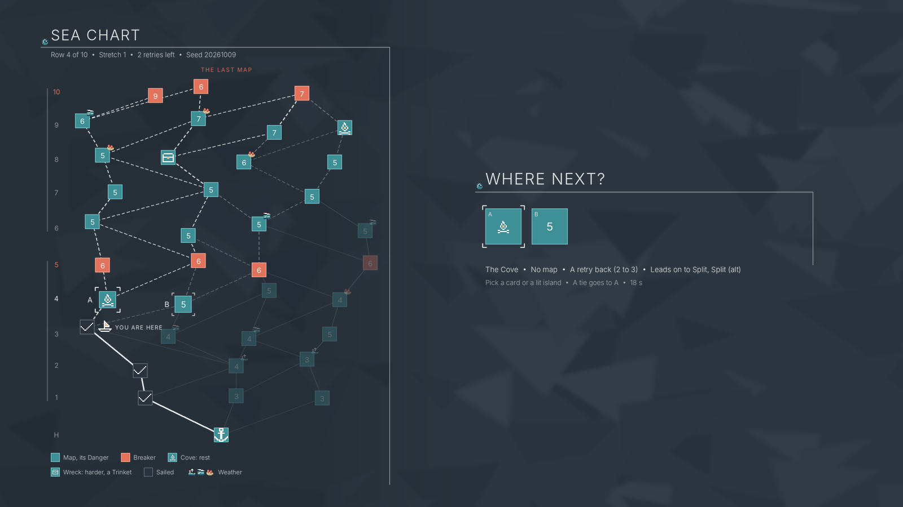
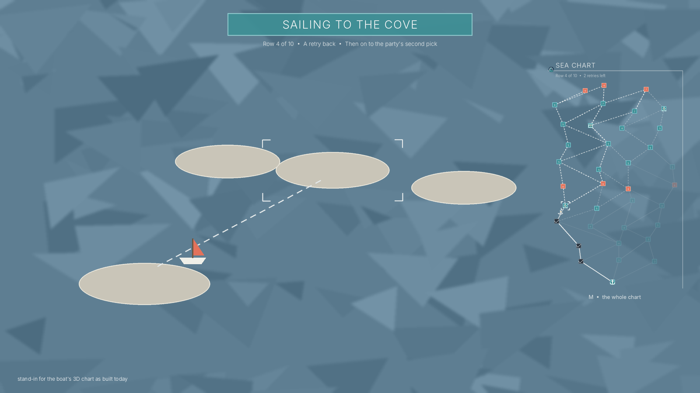

# Navigating the sea chart, with rest and treasure stops (2026-11-06, built, compiled here, not yet run on the PC)

Dimitri asked (2026-11-06 02:18Z): "Expand on the roguelike map. Navigating the map should be closer to navigating the
sea chart on the spotlight artifact, similar to Slay the Spire 2. Navigation through just the nodes feels a little
bit confusing for the player." Asked whether that should also bring new kinds of stop, he picked **"Add rest and
treasure stops"** (02:28Z). This page proposes both: **what the players see and how they pick** (§1-3), and **the
Cove and the Wreck** (§4). The chart's rows, links, maps and weather stay as `SEA_CHART.md` has them. Nothing here is
built on his "go" (05:59Z) with the §7 defaults; §6 marks what compiles here and what needs the PC, §6.1 where the build
differs from this page. Dated summaries: `docs/reports/CHART_NAVIGATION_2026-11-06.md` (the proposal),
`docs/reports/CHART_BUILD_2026-11-06.md` (the build and its PC list).

Tags as in `SEA_CHART.md`: **proven** = shown in game, **read** = from the game's code, **untested** = needs the PC.
Code paths are `TDS_Mod/ModSource/RogueWavesMode/Code/`. `~value~` = a default Claude picked, his to change.

## 1. Why the chart confuses today (read from the mode's code)

The spotlight's chart (`docs/concepts/art/sea_chart_20261009.png`) shows every row at once: where the party is, what
each island leads to, where the stretch closes. The player in game never sees that picture:

1. **The choice is made away from the chart.** Route V1 (`SEA_CHART.md` §4) holds the "where next" vote in the map,
   as a choice dialog of cards (`20_Vote.cs` `MapCard`: the map's name, its weather, "Danger N"). The cards say
   nothing about where each island sits or what comes after it.
2. **The chart is never seen whole.** On the boat the camera stands at the current island's `Cameraposition`
   (`04_World.cs` `CameraSpot`, about 30 units back), framing the next row; rows further on are small or off screen.
3. **The boat moves by itself**, minutes after a vote held in another scene (`05_Boat.cs`); nothing on the boat says
   where it is going or why.
4. **No legend.** A coral flag marks a Breaker, a teal flag a sailed island, a marker a weather, and the game explains
   none of them. "Map N of 10", the stretch and the retries left are on the campaign card (`13_Card.cs`), but not at
   the vote or on the chart.
5. **Danger only shows on the cards.** On the boat the leader's hover shows only the weather billboard (`04_World.cs`
   `Billboard`).
6. **Every island is the same kind of stop** (a map), so a route differs only by Danger and weather.

## 2. What Slay the Spire's map screen does, and our version

| Its map screen | Rogue Waves |
| --- | --- |
| The whole map is one screen you can open at any time | **The chart view**: the whole chart in one view (11 rows fit without scrolling), opened by itself at every vote and by a key at any time (§3.2) |
| Start at the bottom, the boss at the top | The harbour at the bottom, row 10 at the top marked "the last map"; a rail of row numbers with a thin rule beside each stretch, rows 5 and 10 in coral |
| An icon per kind of room, and a legend | Each island a square tile like the stock cards (§3.6): teal with its Danger number; a Breaker coral; the weather's 12 px icon on its corner; a Cove and a Wreck with their own icons (§4); a legend under the chart |
| Rest sites and treasure rooms | **The Cove** (no map: a retry back) and **the Wreck** (a harder map that pays a Trinket), one of each in each stretch (§4) |
| The path taken is drawn in; you see where you stand | Sailed lanes a solid white rule, sailed islands slate with a tick, a boat marker and "YOU ARE HERE" |
| The rooms you can enter next are lit; the rest of the row is greyed | The choices in white corner brackets and lettered A, B, C; islands out of reach from here faded |
| Click a lit room to go there | Click a lit island to vote for it; the stock cards stay for a gamepad (§3.3) |
| Hovering a room shows what it is | Hovering an island (or the card under the pad's focus) puts what it is on the caption line under the cards and lights every lane it leads on to (§3.4) |

*The chart view at row 4's vote, in the game's own UI look (§3.6): seed 20261009 (the spotlight's chart) with the
stops of §4; three maps won (row 2's was a Wreck), one retry spent, the choices a Cove (A, under the pointer) and a map
(B). From `concept-tools/sea_chart_look.py` over a stand-in scene; the first layout draft, in plain shapes, is
`chart_view_vote.png` (`sea_chart_view.py`).*

## 3. The chart view

### 3.1 What it shows

One view with no panel of its own (§3.6), drawn by the mod on every machine from what it already has: the seed and route in the chart's name
(`RWChart`, `RWWorld.Parse`), and the choices from the vote's question. Nothing new crosses the network for the
picture. In a map, a client's chart name is one map behind the host's (`20_Vote.cs` reads it so), so "you are here"
is taken from the map that is loaded, not from the name.

| Part | What it shows |
| --- | --- |
| Header | "SEA CHART" as a stock title, then one caption line: "Row N of 10 • Stretch N • N retries left • Seed N" (the chart's name already carries the retries left, `04_World.cs`; the seed for bug reports) |
| Rail | Row numbers H, 1-10; a thin rule beside each stretch; rows 5 and 10 in coral; the next row's number bright |
| Lanes | Sailed: a solid white rule. Reachable from here: dashed. The hovered choice's way on: dashed, brighter. Out of reach: faint |
| Islands | A square tile per island (§3.6): a map's tile shows its Danger; Breakers coral; the weather's icon on its corner; a Cove's and a Wreck's tiles their pixel icons; sailed tiles slate with a tick; the harbour an anchor; out of reach at a third of the strength |
| Choices | White corner brackets and a letter A, B, C (brighter brackets on your vote) |
| You | The boat marker beside the island the party stands on |
| Legend | One caption line under the chart: Map (its Danger), Breaker, Cove, Wreck, Sailed, the three weathers |
| Footnote | "A tie goes to A; no votes take A" |

**After a loss** the only lit island is the lost one, with "Only this map: 2 retries left" in the header (the rule is
today's, `SEA_CHART.md` §7 step 2); there is no vote then, so the view shows for ~5 s~ as the boat sails back.

### 3.2 When it shows

| Moment | What shows | Input |
| --- | --- | --- |
| The map vote (each map's leave vote; map 1's in the staging map's opening break; the stay vote, B1) | The chart view on the left half, sorted above the dialog's dim; the stock dialog's cards moved to the right half, lettered to match | pick a card, or click a lit island |
| The vote closes | The winning lane flashes, "The party sails to X" (today's line), the view closes after ~2 s~ | none |
| A Cove won | The same view asks the second question at once: where to sail after the Cove (§4.1) | as the map vote |
| On the boat, while it sails | A banner "SAILING TO X, AS VOTED" with the map's Danger and weather (or the Cove's rest); a mini chart top right inking the lane as the boat goes; in the 3D chart white corner brackets on the island it sails to | none |
| On the boat, arrived | The Setup panel as today; the mini chart stays in its corner | as today |
| On the boat with no vote (the host is asked, `05_Boat.cs` `AskHere`) | As the map vote | as the map vote |
| Any time on a chart or in a map's break | The chart view, read only, toggled by a key (~M~) | the key again, or a close button |

*On the boat: the 3D chart stays as built and proven; the banner and the mini chart say where the boat goes.*

**How a client knows where the boat goes.** The host must not put the winner in the chart's name: the host warps
whenever the name changes (`05_Boat.cs`, `RWCampaign.WorldName`) and clears the choice on arrival, so a name with the
winner in it would warp the party again as it lands. Instead every machine reads it from the boat: the boat leaves
the island the party stands on in a straight line for the winner's dock (`SEA_CHART.md` §2, read), and the choices
are at least a lane apart, so ~0.5 s~ of the networked boat's heading names the winner. Until then the banner says
"SETTING SAIL". Untested.

### 3.3 Moving and confirming

- **Who chooses stays as decided:** every map is voted (scope `04` [Sea Chart]); the vote is held in the map (route V1)
  because only the leader can steer on the boat (`SEA_CHART.md` §2, read) and clients have no proven way to vote
  there. The boat still sails to the winner by itself.
- **A pick is a vote.** Clicking a lit island picks its card through a new `RWDialog.Choose(name)`, which answers the
  dialog as a card click does (`RWDialog.Cancel` would close it with no pick), so the same order (`RWVote` `MapKind`)
  goes to the host. The view stays up until the vote closes, showing brighter brackets on your vote and the time left.
- **Changing your mind:** until the timer ends, clicking another lit island sends a new vote; the host already keeps
  each player's last (`RWVote.Votes[session]` is overwritten). Default ~on~.
- **Ties and silence** as today: the most votes wins, a tie goes to the left-most choice (A), nobody voting takes A
  (`20_Vote.cs` `CloseMap`). The footnote says so.
- **The gamepad** keeps the stock cards: a mod panel outside a menu loses pad focus every frame (kit
  `TDS_Vessel_Creator/docs/20_UI_AND_HUD.md` §1.3), so the chart is a picture for the pad and the cards are its buttons.

### 3.4 What the player sees before choosing

- **On the chart:** every island's Danger, weather, Breaker colour, Cove or Wreck; the whole route ahead to row 10; the
  stretch; the retries left; which islands are already out of reach.
- **On the hovered island or focused card:** its map name, Danger and row (a Cove: "No map" and what it gives); its
  weather with the line the Setup panel shows today ("Quickening Current: the game runs faster from Tide 5. More Pure
  Aura"); "Closes stretch N" on a Breaker; a Wreck's "Plays one row harder. Pays each player a Trinket"; "Leads on
  to:" the islands of the next row it links to, with their Danger; and its lanes lit on to row 10.
- **On the card:** today's card (`MapCard`) with its letter; a Cove's and a Wreck's say what they give.

### 3.5 Optional, after his word (§7)

- **Others' votes on the chart** (a vessel pip on each voted island): the cards come from each machine's own
  question; showing others' picks needs the host to write the tally where clients read it, most likely the same vessel
  field the question rides on (`RW_Ask`, proven); the tally itself is untested. Default ~later~.
- **Unknown islands** (Slay the Spire's "?": map and weather hidden until the party is a row away): not in his pick;
  easy to add later with the same second stream (§4.3).

### 3.6 The look: the game's own UI (Dimitri, 2026-11-06 05:23Z: "more inline with the current TDS art style and theme")

The first draft drew the chart as a board of its own (a rounded panel, discs, heavy type). The game's UI is lighter,
and the view now borrows every piece from what the stock dialog, VENDCINT, the objective board and the HUD show in
the PC round 4 pictures (his `round4_for_your_eye.png`):

| Piece | The game's | The chart view |
| --- | --- | --- |
| Background | The choice dialog has no panel: the map stays, under its dim (`Fade`, kit `20` §2) | No panel: the chart floats on the same dim, a little darker on its side so the lanes read over a busy map |
| Title | Capitals centred over the cards; a bright rule under them that turns down the right side, a small knot at the corner, a small glyph standing on the rule's left end (`Title` with `Line`) | "SEA CHART" and "WHERE NEXT?" the same, the glyph the pack's 12 px crest |
| Caption | One short line under the cards, its parts between "•" ("No foe hurts the Basin this Tide • Pays Pure Aura 2 to everyone") | One line under the chart ("Row 4 of 10 • Stretch 1 • 2 retries left") and one under the cards for the hovered island ("The Cove • No map • A retry back (2 to 3) • Leads on to …"), so no floating hover box |
| Tiles | Square cards: a light grey outer frame, a thin gap, then the tile (Rogue Teal `3F8F96`, coral, or slate `5B5D69` for "back") with a darker inner rim | An island is a small square tile built the same way: teal, coral for a Breaker, slate once sailed |
| Icons | Small coloured pixel art in the middle of each card (a bottle, a coin, a hammer); only "back" is a white mark | Cove (a campfire), Wreck (a chest), harbour (an anchor) and boat as coloured 12 × 12 pixel art; the sailed tick white, like "back"; the weathers' existing icons |
| Selection | White corner brackets around the selected thing | The choices and the boat's destination in white corner brackets |
| Banner | "TIDE APPROACHING": a coral bar inside a light grey frame with a gap, plain capitals | "SAILING TO THE COVE" in the same shape, Rogue Teal |
| Type | the game's own font, a plain sans with a slightly pixel feel, normal spacing | the HUD's TMP font, copied from a HUD label (§6); the mockups use Inter as a stand-in, so the type is the one thing they can't show |

The theme comes in through the sea, not ornament: dashed lanes like a course plotted on a chart, the anchor at the
harbour, a boat for "you are here", the Cove's little fire and the Wreck's chest, and Storm Coral only on the rows
that close a stretch (`docs/STYLE.md`: pastel mains, one saturated accent, no black outlines). Over a real map the
view looks like the third picture in his project files (`concepts/chart_navigation_2026-11-06/`, over a round 4
screenshot; not committed, as game pictures stay out of the repository).

## 4. Rest and treasure stops (Dimitri's pick, 2026-11-06 02:28Z)

### 4.1 The Cove (a rest stop)

| | Rule |
| --- | --- |
| Where | One Cove in each stretch, in the row before its Breaker: rows ~4 and 9~, on one island of that row picked by the seed |
| What it is | No map. The boat sails there, the party rests, and the boat sails on |
| What it gives | ~A retry back~, up to 3. With all 3 retries left, ~each player's lowest-ranked held Direction goes up a rank~ instead |
| The vote | Voted like a map. When a Cove wins, the same map asks a second question right away: where to sail after the Cove (its links), so every leg is still voted in a map (route V1, proven channel). Today a map question carries only columns and each machine works out the row from the route (`20_Vote.cs`), which doesn't hold the Cove yet, so the question carries its row (`M:<row>:<cols>`), and `CloseMap` writes the second winner to `RW_Campaign_After`, not `Choice`. When the host picks a Cove on the boat (`AskHere`, no map left to ask in), the host is asked again at the Cove |
| On the boat | The boat sails to the Cove; the host applies its gift and saves; the banner says "THE COVE: A RETRY BACK (2 TO 3)" for ~4 s~; the host warps the party onto the next chart name (the route one longer) and the boat sails on to the second vote's winner, whose Setup panel opens as today. Any change to the chart's name warps the party (`05_Boat.cs`), so the retry and the Cove's route digit change in one write and the name changes once. A warp from chart to chart while the boat is up is new (the proven warps land from the stock world): PC. A client's banner learns the leg after the Cove only when the boat leaves it (§3.2); the host's names it at once |
| Counting | The campaign is still 10 rows, won by leaving row 10's map. A party that rests plays fewer maps (8 if it takes both Coves). The difficulty follows the **row**, not the maps played (~by row~), so a rest skips a map's pay, not its climb |
| Retries and saves | A Cove is never lost or replayed. Its gift is saved with the route in one write, so `Continue` after a quit at the Cove never gives it twice |

### 4.2 The Wreck (a treasure stop)

| | Rule |
| --- | --- |
| Where | One Wreck in each stretch's middle: rows ~2-3 and 6-8~, on one island picked by the seed; never on rows 1, 5 or 10 |
| What it is | A map like the others, its own base map kept, but calm (a Wreck carries no weather: one danger at a time; a Cove, with no map, none either) |
| Harder | It plays ~one row harder~: its Tides, foe health and modifier schedule are the next row's (scope `04` "Numbers", "Changes per campaign") |
| What it pays | When it is won, each player picks ~one Trinket of 3~ the shop may sell and they don't hold, free, held as if bought (scope `12`; the same per-player choice dialog as the Direction picks, proven channel). A Trinket held raises later foes' health like any other (scope `04`: ~+2%~ each), so the pay is also a cost |
| Lost | As any map: a retry is spent and only the Wreck can be picked until it is won |

### 4.3 How the chart places them

- **A second random stream.** The stops are drawn from a second xorshift32 stream, seeded with the chart's seed XOR
  `0x5EA57095`, after the chart is built. The first stream's draws are untouched, so every map, link and weather
  of a seed stays the same (a Cove or a Wreck then drops its weather), and `sea_chart.py --check` still matches today's lines
  for charts without stops. Order of draws: the Cove's column in row 4, then in row 9; the Wreck's row (2 + 0-1) and
  column, then (6 + 0-2) and column. Seed 20261009: Coves at row 4 col 0 and row 9 col 3, Wrecks at row 2 col 0 and
  row 8 col 1 (the mockup).
- **Old campaigns keep old charts.** A campaign saved before the change has no stops (a new save key `RW_Campaign_Stops`
  says a chart has them), so a run in progress never finds its next island turned into a Cove. Clients learn it from
  the chart's name: an `S` after the seed (`RW_Chart_<seed>S_<route>r<retries>`, one byte more, at most 33 of 64), which `RWWorld.Name` writes (through `RWCampaign.WorldName`) and `RWWorld.Parse` reads.
- **Not every route meets a stop**: a Cove is one island of 3 or 4 in its row, so taking it is a route choice, as
  in Slay the Spire.

## 5. What stays

The chart's first stream (rows, links, maps, weather), seeds of campaigns already running, the 3D chart, its camera
and the boat's sail (proven, PC rounds 1-4), the in-map vote's channel and timers, the Setup panel and ready-up, the
weather billboard. A campaign started before the change continues without stops.

## 6. The code (built 2026-11-06, compiled here; the PC column is still to run)

"Here" means it compiles in the cloud check; every self-test runs in the mode's self-test build on the PC.

| File | Change | Here | PC |
| --- | --- | --- | --- |
| new `26_ChartView.cs` | An own Canvas (Screen Space Overlay, `CanvasScaler`, the save's `Settings/Uiscale`, sorted above the choice dialog's dim but on the left half only; kit `20` §4); the full and mini layouts from `RWChart.Chart`, the route and the choices; lanes as stretched `Image`s (dashed from a small repeating texture made in code), square tiles and corner brackets as `Image`s, the stock dialog's title-and-rule copied from `Bla_Ui_Confirmation`'s `Title` with its Blockage components stripped (kit `20` §4), labels in a TMP font copied from a HUD label, icons from `RWIcons`; the layout math in one static function the self-test can call | compiles | its look, UI scale, sorting against the dialog, the Setup panel, pause and the HUD; the layout's counts (self-test) |
| `11_Dialog.cs` | The letter on each card; the cards placed on the right half while the view is up (they are centred today); `Choose(name)`; which card holds the pad's focus (`EventSystem.current.currentSelectedGameObject`), for the highlight | compiles | the placement after the dialog's slide-in; the focus read with a pad |
| `20_Vote.cs` | Open the view with every map question, pass the choices and letters, close it at `CloseMap`; a click on a lit island answers through `Choose`; a second click sends a new vote; the Cove's second question with its row in the question (`M:<row>:<cols>`), its winner to `RW_Campaign_After`; the Wreck's Trinket pick after its win | compiles | **whether clicks reach the view sorted above the dialog without upsetting the dialog** (if not, the chart stays a picture and the cards pick: the fallback costs nothing); a client's re-vote reaching the host; the Cove's second question on a client |
| `05_Boat.cs` | The banner and the mini chart while the boat sails (the winner from the boat's heading, §3.2); the view beside `AskHere`'s dialog; the Cove's stop: arrive, gift, save, banner, warp, sail on; the host asked again at a Cove picked on the boat | compiles | a client's banner in a two-player round; a code-built stop with no map (a `Macro_Nodelink_Add`, or a map node the host never selects); the chart-to-chart warp with the boat up |
| `04_World.cs` | White corner brackets on the island the boat sails to; the Cove's and the Wreck's marks on their islands; `S` in the chart's name | compiles | the look |
| `03_Chart.cs`, `concept-tools/sea_chart.py` | The stops' second stream (§4.3), ported from `sea_chart_view.py`'s `stops()`; `--check` lines gain the stop | compiles; the Python and C# lines compared | the `CHART` lines in the PC log |
| `06_Campaign.cs`, `13_Card.cs` | `RW_Campaign_Stops` and the name's `S`; the route counts rows sailed (a Cove's column included); the Cove's gift saved with its column in one write; the second vote's winner kept (`RW_Campaign_After`); the campaign card's "Map N of 10" becomes "Row N of 10" on charts with stops | compiles | `Continue` at the Cove |
| `21_Difficulty.cs`, `14_Run.cs`, `24_Trinkets.cs` | A Wreck plays one row ahead; its pay | compiles | the numbers in the log |
| `12_Menu.cs` or the view | The key (~M~) read with `InputSystem.Keyboard.current`, ignored while a chat or text field has focus, never while the choice dialog is up | compiles | no clash with the game's keys; typing "m" in chat |
| `99_SelfTest.cs`, `97_Shots.cs` | New checks CV1-CV12 (§8) and pictures of the vote and the sailing boat for his eye | compiles | runs in the self-test |
| `08_Icons.cs`, temporary art | 12 px coloured pixel icons (Cove, Wreck, harbour, tick, boat; `sea_chart_look.py` `PIX`) in `Art/Temporary` (`docs/TEMP_ART.md`) | drawn here | his eye |

No kit change was needed to write it; anything the PC teaches goes to kit `docs/20` and the pitfalls then. Scope `04`
[Sea Chart] lists the chart view, the Cove and the Wreck with this page's defaults in tildes (PR #146).

### 6.1 Where the build differs from the plan above

1. **The view's title** is drawn with its own Images and a TMP label in the stock dialog's colours, not copied from
   `Bla_Ui_Confirmation`'s `Title` (one less object to strip of Blockage components; the look is his to judge, CV8).
2. **The pointer and the key** are read with `UnityEngine.InputSystem` (`Mouse.current`, `Keyboard.current`) and the
   islands' rectangles, not through EventSystem raycasts. The shade on the chart's half takes raycasts, so a click on
   the chart never reaches the game under it. While another dialog is up (SHOP, FUND, the game's own) the view hides.
3. **Not built yet:** the 3D white corner brackets on the island the boat sails to (§3.2; the banner and the mini chart
   name it), the 5 s view after a lost map, and the flash of the winning lane. Each is a small follow-up after the PC
   has shown the rest.
4. **The Cove on the boat** is always blacklisted in `Macro_Main`; the host's Sail hovers it, and a boat standing at its
   dock 1.5 s with no vote is the rest too. The rest is one save write, then the party warps chart-to-chart onto the new
   name and sails on to the second vote's winner (or the host is asked, `AskHere`).
5. **Not done from the table above:** the `97_Shots.cs` pictures of the vote and the boat (the PC round takes them by
   hand, CV8); the pixel icons are drawn in code (`08_Icons.cs`, from `sea_chart_look.py` `PIX`), not files in
   `Art/Temporary`; the key lives in the view, not `12_Menu.cs`; the Wreck's pay is in `20_Vote.cs` and
   `17_Cardinals.cs` (`Give`), not `14_Run.cs` or `24_Trinkets.cs` (which gains only `OnGain`).
6. **Older self-tests** play charts without stops (`RWCampaign.StopsOnNew` off at boot); `90_Stops.cs` turns it on for
   its own campaign. A new campaign in a release build has stops.

## 7. Choices for Dimitri (defaults taken; the proposal doesn't wait on them)

1. ~~New kinds of stop~~: **answered 02:28Z, rest and treasure stops** (§4).
2. The Cove's gift: ~a retry back, or a Direction rank when none is spent~; its rows ~4 and 9~.
3. The Wreck: ~one row harder~, ~one Trinket of 3~ for each player; its rows ~2-3 and 6-8~.
4. Difficulty after a rest follows the row: ~yes~.
5. The key that opens the chart: ~M~. Changing a vote before the timer ends: ~on~. Others' votes on the chart:
   ~later~. The mini chart on the boat: ~top right, all the time on the chart~.

## 8. Checks for the build and its PC round

| # | Pass when | Where |
| --- | --- | --- |
| CV1 | The view has one tile per island and one lane per link (seed 20261009: 37 islands, 59 lanes) | self-test |
| CV2 | Only the vote's choices are lit and lettered, in the dialog's order | self-test |
| CV3 | The faded islands are exactly those not reachable from where the party stands | self-test |
| CV4 | A click on a lit island lands in `RWVote.Votes` as the card would; a second click replaces it | self-test, then by hand |
| CV5 | The view closes with the vote and leaves no canvas behind, in the map and on the boat | self-test |
| CV6 | On the boat the banner names the island sailed to on the host and a client, and the mini chart's boat follows the real one | two-player round |
| CV7 | The key toggles the view on the boat and in a break, not while typing in chat | by hand |
| CV8 | His eye: the layout at 1080p and his UI scale, beside the cards, with the Setup panel; a pad pick | pictures and by hand |
| CV9 | 500 charts: one Cove in rows 4 and 9, one Wreck in rows 2-3 and 6-8, every Wreck calm; with stops off, the `CHART` lines equal today's | self-test, and `sea_chart.py --check` here |
| CV10 | A Cove's win asks the second question; the boat stops at the Cove, the retry comes back once, the party warps and sails on, and the second winner's Setup panel opens | self-test |
| CV11 | `Continue` after a quit at the Cove neither gives its gift twice nor skips the leg after it | self-test |
| CV12 | A Wreck plays the next row's numbers (logged) and, once won, each player gets their Trinket pick and holds it after | self-test, then two-player |
