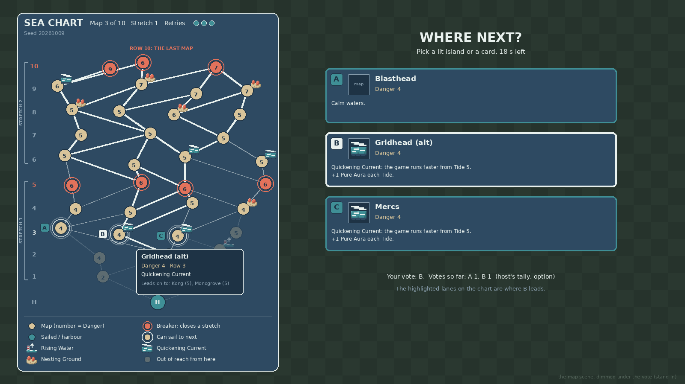
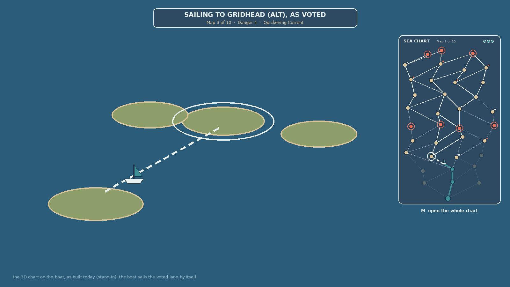

# Navigating the sea chart (2026-11-06, proposal, not built)

Dimitri asked (2026-11-06 02:18Z): "Expand on the roguelike map. Navigating the map should be closer to navigating the
sea chart on the spotlight artifact, similar to Slay the Spire 2. Navigation through just the nodes feels a little
bit confusing for the player." This page proposes how. The chart itself (its rows, links, maps, weather, seed and
save) is `SEA_CHART.md` and stays as it is; this page changes only **what the players see and how they pick**.
Nothing here is built; §5 marks what compiles here and what needs the PC. Dated summary:
`docs/reports/CHART_NAVIGATION_2026-11-06.md`.

Tags as in `SEA_CHART.md`: **proven** = shown in game, **read** = from the game's code, **untested** = needs the PC.
Code paths are `TDS_Mod/ModSource/RogueWavesMode/Code/`.

## 1. Why the chart confuses today (read from the mode's code)

The spotlight's chart (`docs/concepts/art/sea_chart_20261009.png`) shows every row at once: where the party is, what
each island leads to, where the stretch closes. The player in game never sees that picture:

1. **The choice is made away from the chart.** Route V1 (`SEA_CHART.md` §4) holds the "where next" vote in the map,
   as a choice dialog of cards (`20_Vote.cs` `MapCard`: the map's name, its weather, "Danger N"). The cards say
   nothing about where each island sits or what comes after it.
2. **The chart is never seen whole.** On the boat the camera stands at the current island's `Cameraposition`
   (`04_World.cs` `CameraSpot`, about 30 units back), framing the next row; rows further on are small or off screen.
3. **The boat moves by itself**, minutes after a vote held in another scene (`05_Boat.cs`); nothing on the boat says
   where it is going or why.
4. **No legend, no progress.** A coral flag marks a Breaker, a teal flag a sailed island, a marker a weather, and the
   game explains none of them; nothing says "map 3 of 10", the stretch, or the retries left.
5. **Danger only shows on the cards.** On the boat the leader's hover shows only the weather billboard (`04_World.cs`
   `Billboard`).

## 2. What Slay the Spire's map screen does, and our version

| Its map screen | Rogue Waves |
| --- | --- |
| The whole map is one screen you can open at any time | **The chart view**: the whole chart on one flat panel (11 rows fit without scrolling), opened by itself at every vote and by a key at any time (§3.2) |
| Start at the bottom, the boss at the top | The harbour at the bottom, row 10 at the top marked "the last map"; a rail of row numbers with the two stretches bracketed, rows 5 and 10 in coral |
| An icon per kind of room, and a legend | Each island a disc: Wet Sand with its Danger number; a Breaker in coral with a ring; the weather's 12 px icon on its shoulder; a legend under the chart |
| The path taken is drawn in; you see where you stand | Sailed lanes thick Rogue Teal, sailed islands ticked, a boat marker and "YOU ARE HERE" |
| The rooms you can enter next are lit; the rest of the row is greyed | The choices ringed and lettered A, B, C; islands out of reach from here faded |
| Click a lit room to go there | Click a lit island to vote for it; the stock cards stay for a gamepad (§3.3) |
| Hovering a room shows what it is | Hovering an island (or the card under the pad's focus) shows its card and lights every lane it leads on to (§3.4) |

*The chart view at map 3's vote, seed 20261009 (the spotlight's chart): two maps won, three choices, the pointer on
B. Plain shapes to agree the layout on, from `concept-tools/sea_chart_view.py`; the game draws its own map names.*

## 3. The design

### 3.1 The chart view

One panel, drawn by the mod on every machine from what it already has (the seed and route in the chart's name,
`RWChart`; the choices from the vote's question), so nothing new crosses the network for the picture itself.

| Part | What it shows |
| --- | --- |
| Header | "SEA CHART", "Map N of 10", the stretch, three retry pips (spent ones hollow; the chart's name already carries the retries left, `04_World.cs`); the seed small, for bug reports |
| Rail | Row numbers H, 1-10; "STRETCH 1" and "STRETCH 2" brackets; rows 5 and 10 in coral; the next row's number bright |
| Lanes | Sailed: thick teal. Reachable from here: Foam. The hovered choice's way on: Foam, thicker. Out of reach: faint |
| Islands | A disc per map with its Danger number; Breakers coral and ringed; weather icon; sailed ticked; harbour "H"; out of reach at a third of the strength |
| Choices | A double ring and a letter tag A, B, C (the tag filled when it is your vote) |
| You | The boat marker beside the island the party stands on |
| Legend | Map (number = Danger), Breaker, sailed or harbour, can sail to next, the three weathers, out of reach |

**After a loss** the only lit island is the lost one, with "Retry 2 of 3: only this map" in the header (the rule is
today's, `SEA_CHART.md` §7 step 2); there is no vote then, so the view shows for ~5 s~ as the boat sails back.

### 3.2 When it shows

| Moment | What shows | Input |
| --- | --- | --- |
| The map vote (each map's leave vote; map 1's in the staging map's opening break; the stay vote, B1) | The chart view on the left half, the stock choice dialog on the right with its cards lettered to match | pick a card, or click a lit island |
| The vote closes | The winning lane flashes, "The party sails to X" (today's line), the view closes after ~2 s~ | none |
| On the boat, while it sails | A banner "SAILING TO X, AS VOTED" with the map's Danger and weather; a mini chart top right inking the lane as the boat goes; in the 3D chart a Foam ring on the voted island and its lane drawn bright | none |
| On the boat, arrived | The Setup panel as today; the mini chart stays in its corner | as today |
| On the boat with no vote (the host is asked, `05_Boat.cs` `AskHere`) | As the map vote | as the map vote |
| Any time on a chart or in a map's break | The chart view, read only, toggled by a key (~M~) | the key again, or a close button |

*On the boat: the 3D chart stays as built and proven; the banner and the mini chart say where the boat goes.*

### 3.3 Moving and confirming

- **Who chooses stays as decided:** every map is voted (scope `04` [Sea Chart]); the vote is held in the map (route V1)
  because only the leader can steer on the boat (`SEA_CHART.md` §2, read) and clients have no proven way to vote
  there. The boat still sails to the winner by itself.
- **A pick is a vote.** Clicking a lit island sends the same order as its card (`RWVote` `MapKind`), and the dialog
  closes as it does today. The view stays up until the vote closes, showing your tag filled and the time left.
- **Changing your mind:** until the timer ends, clicking another lit island sends a new vote; the host already keeps
  each player's last (`RWVote.Votes[session]` is overwritten). Default ~on~.
- **Ties and silence** as today: the most votes wins, a tie goes to the left-most choice (A), nobody voting takes A
  (`20_Vote.cs` `CloseMap`). The view's footnote says so.
- **The gamepad** keeps the stock cards: a mod panel outside a menu loses pad focus every frame (kit
  `TDS_Vessel_Creator/docs/20_UI_AND_HUD.md` §1.3), so the chart is a picture for the pad and the cards are its buttons.

### 3.4 What the player sees before choosing

- **On the chart:** every island's Danger, weather and Breaker ring; the whole route ahead to row 10; the stretch;
  the retries left; which islands are already out of reach.
- **On the hovered island or focused card:** its map name, Danger and row; its weather with the line the Setup panel
  shows today ("Quickening Current: the game runs faster from Tide 5. More Pure Aura"); "Closes stretch N" on a
  Breaker; "Leads on to:" the islands of the next row it links to, with their Danger; and its lanes lit on to row 10.
- **On the card:** today's card (`MapCard`) with its letter.

### 3.5 Optional, after his word (§6)

- **Others' votes on the chart** (a vessel pip on each voted island, "A 1, B 1"): the cards come from each machine's
  own question; showing others' picks needs the host to write the tally where clients read it, most likely the same
  vessel field the question rides on (`RW_Ask`, proven); the tally itself is untested. Default ~later~.
- **New kinds of island** (a Slay the Spire "?", a rest stop, a treasure stop): change the chart's generator, the
  Python port, and the scope's ten-maps rule; Dimitri's call (§6 item 1).

## 4. What stays

The chart's generator (`03_Chart.cs`, `concept-tools/sea_chart.py`), seeds, the save keys and a running campaign;
the 3D chart, its camera and the boat's sail (proven, PC rounds 1-4); the in-map vote's channel and timers; the
Setup panel and ready-up; the weather billboard. A campaign started before the change continues unchanged.

## 5. The code it implies (not built)

| File | Change | Here | PC |
| --- | --- | --- | --- |
| new `26_ChartView.cs` | An own Canvas (Screen Space Overlay, `CanvasScaler`, the save's `Settings/Uiscale`, sorting above the HUD and below the choice dialog; kit `20` §4); the full and mini layouts from `RWChart.Chart`, the route and the choices; lanes as stretched `Image`s, discs from one circle sprite made in code, labels in a TMP font copied from a HUD label, icons from `RWIcons`; the layout math in one static function the self-test can call | compiles; the layout's counts by self-test | its look, UI scale, sorting against the dialog, the Setup panel, pause and the HUD |
| `20_Vote.cs` | Open the view with every map question, pass the choices and letters, close it at `CloseMap`; a click on a lit island answers as the card does (`RWDialog` callback, then `RWDialog.Cancel`); a second click sends a new vote | compiles | **whether the choice dialog lets clicks through to a panel beside it** (if it blocks them, the chart stays a picture and the cards pick: the fallback costs nothing); a client's re-vote reaching the host |
| `11_Dialog.cs` | The letter on each card; which card holds the pad's focus (`EventSystem.current.currentSelectedGameObject`), for the highlight | compiles | the focus read with a pad |
| `05_Boat.cs` | The banner and the mini chart while the boat sails (the share of the lane sailed from the boat's position, which every machine has); the view beside `AskHere`'s dialog | compiles | on a client in a two-player round |
| `04_World.cs` | A Foam ring on the voted island and its lane drawn bright | compiles | the look |
| `04_World.cs`, `05_Boat.cs` | Clients learn the vote's winner for the banner and ring: the host adds it to the chart's name, after the retries it already carries (`RW_Chart_<seed>_<route>r<retries>v<col>`, at most 34 bytes of the 64; `SEA_CHART.md` §3), and `RWWorld.Parse` reads it; the save guard tests only the prefix (`RWData.WorldPrefix`), so it still matches | compiles; `CH`-style self-test on names | two-player round |
| `12_Menu.cs` or the view | The key (~M~) read with `UnityEngine.Input`, ignored while a chat or text field has focus, never while the choice dialog is up | compiles | no clash with the game's keys; typing "m" in chat |
| `99_SelfTest.cs`, `97_Shots.cs` | New checks CV1-CV7 (§7) and pictures of the vote and the sailing boat for his eye | compiles | runs in the mode's self-test |

No kit change is needed to write it; anything the PC teaches goes to kit `docs/20` and the pitfalls then. The temporary
art is code-drawn shapes plus the existing 12 px icons; the boat marker and the letter tags could get pixel art later
(`docs/TEMP_ART.md`).

## 6. Choices for Dimitri (defaults taken; the proposal doesn't wait on them)

1. **New kinds of island** (asked in the thread): navigation only for now (recommended), or also unknown islands, or
   also rest and treasure stops.
2. The key that opens the chart: ~M~.
3. Changing a vote before the timer ends: ~on~.
4. Others' votes on the chart: ~later~.
5. The mini chart on the boat: ~top right, all the time on the chart~.

Once he says go, scope `04` [Sea Chart] gains a "Navigation" line pointing here.

## 7. Checks for the build and its PC round

| # | Pass when | Where |
| --- | --- | --- |
| CV1 | The view has one disc per island and one lane per link (seed 20261009: 37 islands, 59 lanes) | self-test |
| CV2 | Only the vote's choices are lit and lettered, in the dialog's order | self-test |
| CV3 | The faded islands are exactly those not reachable from where the party stands | self-test |
| CV4 | A click on a lit island lands in `RWVote.Votes` as the card would; a second click replaces it | self-test, then by hand |
| CV5 | The view closes with the vote and leaves no canvas behind, in the map and on the boat | self-test |
| CV6 | On the boat the banner names the voted map on the host and a client, and the mini chart's boat follows the real one | two-player round |
| CV7 | The key toggles the view on the boat and in a break, not while typing in chat | by hand |
| CV8 | His eye: the layout at 1080p and his UI scale, beside the cards, with the Setup panel; a pad pick | pictures and by hand |
